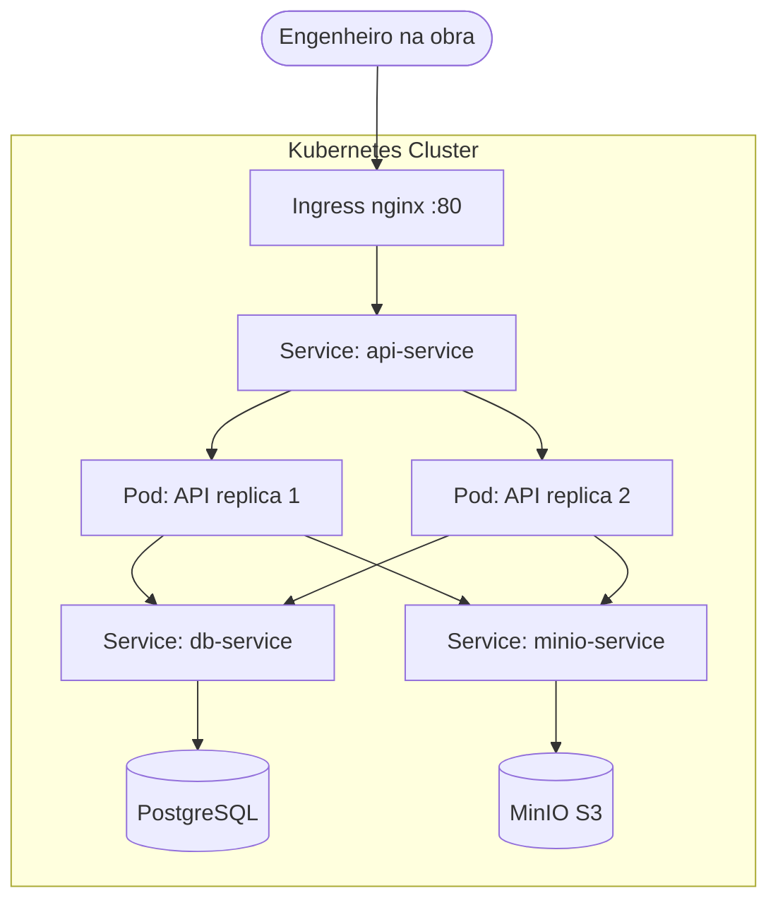
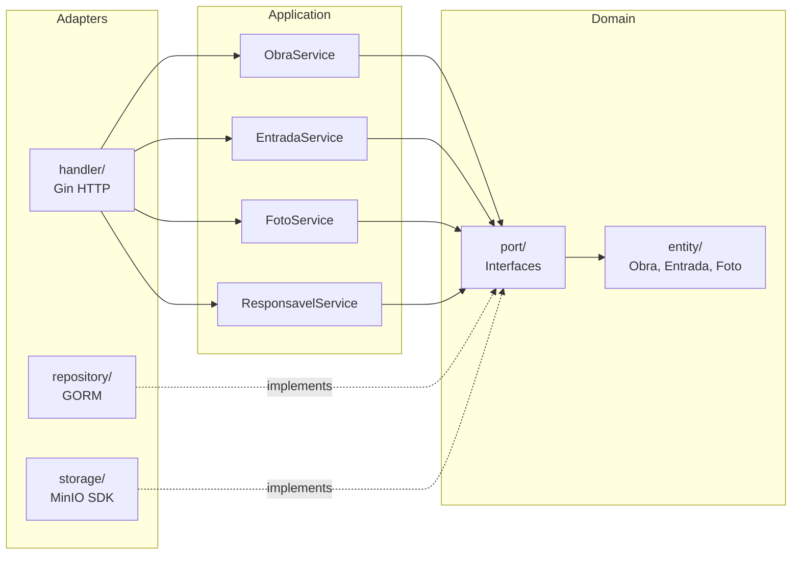
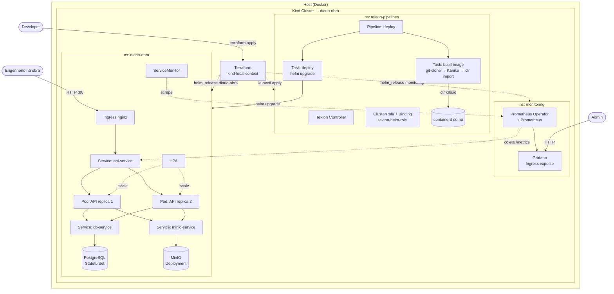
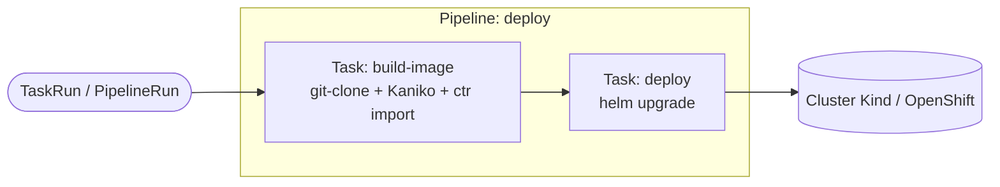
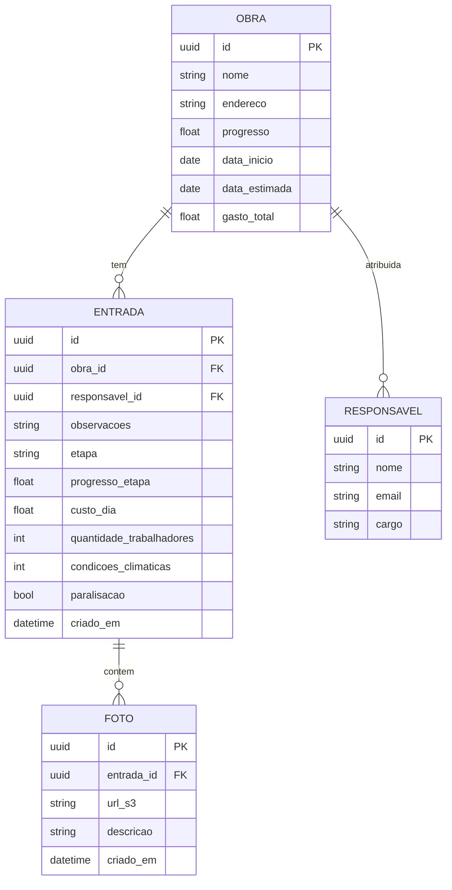

# Diário de Obra

API REST para registro digital de obras de construção civil. O engenheiro registra entradas diárias com progresso, custos, condições climáticas e fotos.

Projeto de estudo de **Go + Docker + Kubernetes + IaC + CI/CD** com arquitetura Ports and Adapters.

## Destaques

- **Imagem de ~600MB para 35MB** (-94%): multi-stage build + `distroless/static` rodando como `nonroot`, sem shell e sem package manager
- **Build multi-arquitetura**: `--platform=$BUILDPLATFORM` + `TARGETOS`/`TARGETARCH` com `CGO_ENABLED=0` (builda no Mac ARM e roda em nó AMD64)
- **Escala horizontal**: 2 réplicas da API com HPA escalando até 6 por CPU (70%)
- **Um comando sobe tudo**: `terraform apply` provisiona namespace, Prometheus + Grafana, a aplicação via Helm e o Tekton
- **CI/CD dentro do cluster**: pipeline Tekton com Kaniko, **sem registry externo** e **sem montar `docker.sock`**
- **Observabilidade desde o início**: métricas RED (`http_requests_total`, `http_request_duration_seconds`) com scraping via `ServiceMonitor`
- **Roda em Kind e em OpenShift** com o mesmo Helm chart

## Decisões técnicas

| Decisão | Por quê |
|---------|---------|
| Ports and Adapters | Domínio e casos de uso não dependem de Gin, GORM nem MinIO; cada adapter implementa uma interface em `domain/port` |
| Distroless `nonroot` | Superfície de ataque mínima: sem shell, sem package manager, sem root |
| Kaniko `--no-push --tar-path` + `ctr import` no namespace `k8s.io` | A imagem vai direto pro containerd do nó, visível pro kubelet, sem registry e sem expor o socket do Docker |
| `ClusterRole` dedicado pro Tekton | A ServiceAccount do Tekton só ganha permissão nos tipos de recurso que o chart cria (Deployment, StatefulSet, Service, HPA, Ingress, ServiceMonitor...) |
| `depends_on` entre `helm_release` | O chart da aplicação cria um `ServiceMonitor`, cuja CRD só existe depois do kube-prometheus-stack |
| Tekton via `null_resource` + `kubectl apply` | O `release.yaml` oficial mistura CRDs e instâncias, o que o `kubernetes_manifest` não valida no plan. Trade-off: esse recurso fica sem state management |
| Credenciais fora do git | Variáveis `sensitive = true`, `terraform.tfvars` e `values-secrets.yaml` no `.gitignore` |

## English summary

REST API in **Go** (Gin + GORM, Ports and Adapters) for digital construction-site logs: daily entries, progress, costs, weather, and photos stored in **MinIO** (S3). The project is a hands-on platform engineering study:

- **Docker**: multi-stage distroless `nonroot` image, from ~600MB to **35MB**, with multi-arch builds
- **Kubernetes** (Kind and OpenShift): StatefulSet for PostgreSQL, 2 API replicas with **HPA up to 6**, Ingress, and a Helm chart
- **Terraform**: one `terraform apply` provisions the namespace, kube-prometheus-stack, the app, and Tekton
- **Tekton CI/CD** inside the cluster: Kaniko build without an external registry or `docker.sock`, then a `helm upgrade`
- **Observability**: Prometheus RED metrics scraped through a `ServiceMonitor`, visualized in Grafana

## Stack

- **Go** (Gin + GORM) — API REST
- **PostgreSQL** — Banco de dados
- **MinIO** — Object storage S3-compatible (fotos)
- **Swagger** — Documentação interativa da API
- **Prometheus + Grafana** — Métricas e dashboards (via kube-prometheus-stack)
- **Docker** — Multi-stage build com distroless (35MB)
- **Kubernetes** — Orquestração com Kind (local) e OpenShift
- **Helm** — Chart para deploy em Kubernetes e OpenShift
- **Terraform** — Provisionamento declarativo do cluster (namespaces, Helm releases, Tekton)
- **Tekton** — Pipeline CI/CD nativa em Kubernetes (build com Kaniko + deploy com Helm)

## Arquitetura



## Arquitetura interna — Ports and Adapters



## Infraestrutura completa



## Pipeline CI/CD (Tekton)



## Modelo de dados



## Endpoints

| Metodo | Rota | Descricao |
|--------|------|-----------|
| GET | `/ping` | Health check |
| GET | `/swagger/*any` | Documentacao Swagger |
| GET | `/api/v1/metrics` | Metricas Prometheus |
| | | |
| **Obras** | | |
| POST | `/api/v1/obras` | Criar obra |
| GET | `/api/v1/obras` | Listar obras |
| GET | `/api/v1/obras/:id` | Buscar obra |
| PUT | `/api/v1/obras/:id` | Atualizar obra |
| DELETE | `/api/v1/obras/:id` | Deletar obra |
| | | |
| **Entradas** | | |
| POST | `/api/v1/obras/:id/entradas` | Criar entrada |
| GET | `/api/v1/obras/:id/entradas` | Listar entradas da obra |
| GET | `/api/v1/entradas/:id` | Buscar entrada |
| DELETE | `/api/v1/entradas/:id` | Deletar entrada |
| | | |
| **Fotos** | | |
| POST | `/api/v1/entradas/:id/fotos` | Upload foto (multipart) |
| GET | `/api/v1/entradas/:id/fotos` | Listar fotos da entrada |
| DELETE | `/api/v1/entradas/:id/fotos/:fotoId` | Deletar foto |
| | | |
| **Responsaveis** | | |
| POST | `/api/v1/responsaveis` | Criar responsavel |
| GET | `/api/v1/responsaveis` | Listar responsaveis |
| GET | `/api/v1/responsaveis/:id` | Buscar responsavel |
| PUT | `/api/v1/responsaveis/:id` | Atualizar responsavel |
| DELETE | `/api/v1/responsaveis/:id` | Deletar responsavel |

## Rodando com Docker Compose

```bash
# Criar o .env (gitignored) com as credenciais locais
cat > .env <<EOF
DB_HOST=localhost
DB_PORT=5432
DB_USER=diario
DB_PASSWORD=troque-esta-senha
DB_NAME=diario_obra
MINIO_ENDPOINT=localhost:9000
MINIO_USER=minio
MINIO_PASSWORD=troque-esta-senha
MINIO_BUCKET=diario-fotos
EOF

docker compose up -d
curl http://localhost:8080/ping
```

## Rodando com Kubernetes (Kind) — manifests

```bash
# Criar cluster
kind create cluster --name diario-obra --config kind-config.yaml

# Build e carregar imagem
docker build -t diario-obras-api:latest .
kind load docker-image diario-obras-api:latest --name diario-obra

# Aplicar manifests
kubectl apply -f k8s/namespace.yaml
kubectl apply -f k8s/configmap.yaml
kubectl apply -f k8s/secret.yaml
kubectl apply -f k8s/postgres.yaml
kubectl apply -f k8s/minio.yaml
kubectl apply -f k8s/api.yaml
kubectl apply -f k8s/ingress.yaml
kubectl apply -f k8s/hpa.yaml

# Instalar Ingress controller
kubectl apply -f https://kind.sigs.k8s.io/examples/ingress/deploy-ingress-nginx.yaml

# Testar
curl http://localhost/ping
```

## Rodando com Helm

```bash
# Criar o arquivo de secrets (gitignored) com credenciais reais
cat > chart/values-secrets.yaml <<EOF
database:
  user: diario
  password: troque-esta-senha
storage:
  user: minio
  password: troque-esta-senha
EOF

# Deploy local (Kind)
helm install diario-obra ./chart -n diario-obra --create-namespace -f chart/values-secrets.yaml

# Deploy OpenShift
helm install diario-obra ./chart -n diario-obra --create-namespace \
  -f chart/values-openshift.yaml \
  -f chart/values-secrets.yaml
```

## Provisionamento com Terraform

O Terraform provisiona, em um cluster Kind já existente (contexto `kind-local`):

- Namespace `diario-obra`
- Helm release do kube-prometheus-stack (Prometheus + Grafana) no namespace `monitoring`
- Helm release da aplicação usando o chart em `./chart`
- Instalação das Tekton Pipelines (via `kubectl apply`)

```bash
cd terraform

# Criar terraform.tfvars com as credenciais
cat > terraform.tfvars <<EOF
database_user          = "diario"
database_password      = "..."
storage_user           = "minio"
storage_password       = "..."
grafana_admin_password = "..."
EOF

terraform init
terraform apply
```

## Pipeline Tekton

A pipeline `deploy` roda dois Tasks sequenciais em um workspace compartilhado:

1. **build-image** — clona o repo, builda a imagem com Kaniko (`--no-push --tar-path`) e importa o tar no containerd do nó via `ctr` (namespace `k8s.io`).
2. **deploy** — roda `helm upgrade` do chart com as credenciais injetadas por parâmetro.

```bash
# RBAC para a ServiceAccount default do namespace tekton-pipelines
kubectl apply -f tekton/rbac.yaml

# Tasks e Pipeline
kubectl apply -f tekton/task-build.yaml
kubectl apply -f tekton/task-deploy.yaml
kubectl apply -f tekton/pipeline.yaml

# Executar apenas o build
kubectl apply -f tekton/taskrun-build.yaml
```

## Observabilidade

O middleware Prometheus coleta automaticamente:

- `http_requests_total` — contador por metodo, rota e status
- `http_request_duration_seconds` — histograma de latencia

Endpoint de métricas: `GET /api/v1/metrics`

No Kubernetes, o `ServiceMonitor` faz scraping automático a cada 15s para o Prometheus Operator (instalado via kube-prometheus-stack pelo Terraform). O Grafana fica exposto pelo `k8s/grafana-ingress.yaml`.

## Estrutura do projeto

```
├── cmd/api/main.go
├── internal/
│   ├── domain/
│   │   ├── entity/        # Obra, Entrada, Foto, Responsavel
│   │   └── port/          # Interfaces (repositories, storage)
│   ├── application/       # Services (use cases)
│   └── adapter/
│       ├── handler/       # Gin HTTP handlers + router
│       ├── repository/    # GORM implementations
│       └── storage/       # MinIO S3 implementation
├── docs/                  # Swagger (gerado pelo swag)
├── k8s/                   # Kubernetes manifests
├── chart/                 # Helm chart (Kind + OpenShift)
├── terraform/             # IaC: namespace, Helm releases, Tekton
├── tekton/                # Pipeline CI/CD (build Kaniko + deploy Helm)
├── Dockerfile             # Multi-stage distroless (35MB)
├── docker-compose.yml
└── kind-config.yaml
```

## Docker — progressão de tamanho

| Imagem | Tamanho |
|--------|---------|
| golang:alpine (runtime) | ~600MB |
| Alpine multi-stage | 75MB |
| Distroless multi-stage | **35MB** |

## Roadmap

- [x] Fase 1 — Docker multi-stage + distroless
- [x] Fase 2 — MinIO upload de fotos
- [x] Fase 3 — Kubernetes com Kind
- [x] Fase 4 — Helm chart + métricas Prometheus
- [x] Fase 5 — Suporte a OpenShift
- [x] Fase 6 — IaC com Terraform (cluster, monitoring, Tekton)
- [x] Fase 7 — CI/CD com Tekton (build Kaniko + deploy Helm)
- [ ] Fase 8 — Triggers + webhook GitHub

## Autor

Victor Gabriel — [@v1c-g4b](https://github.com/v1c-g4b)

Acompanhe a jornada no [LinkedIn](https://www.linkedin.com/in/victorgabriel-engineer/) — #buildinpublic
